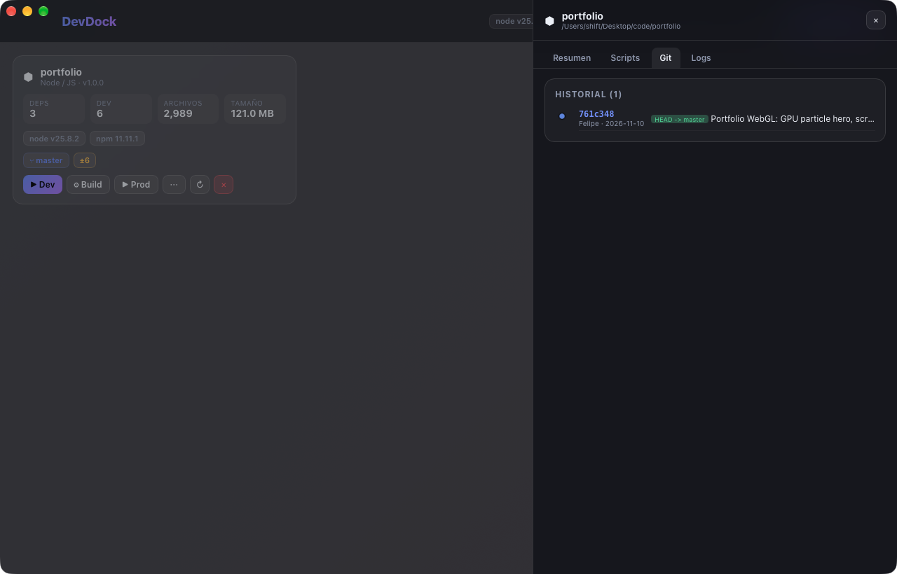

# DevDock

<div align="center">


**Your projects, moored and ready.**

</div>

Dashboard de proyectos para macOS: arrastra carpetas (Node, Rust, Tauri, Python, Java, Go…) y ten métricas, dev servers, builds y el historial de Git a un vistazo.

  

## Screenshots

| Dashboard | Detalle (Git graph) | Logs |
|---|---|---|
|  |  |  |

## Qué hace

- **Drag & drop** de carpetas de proyectos y detección automática del tipo (package.json, Cargo.toml, pyproject.toml, pom.xml, go.mod…).
- **Métricas al tiro**: versión, dependencias/devDeps, nº de archivos, tamaño, runtimes instalados (node/npm/python/cargo/java/go/git).
- **Acciones con un click**: dev server, build, prod, test — por tipo de proyecto (npm, cargo, gradle, go, pytest). Procesos en su propio process group: el botón ■ Stop mata el árbol completo (npm → vite), no solo al wrapper.
- **Git a un vistazo**: rama, dirty files, ahead/behind, y graph de commits con lanes de branches/merges. Si el proyecto no tiene repo, botón para `git init`.
- **Logs en vivo** por proyecto (stdout/stderr + eventos de salida).
- **Persistencia**: la lista de proyectos sobrevive al reiniciar (localStorage).

## Arquitectura

```
src/                 React 19 + Vite (frontend, glass UI)
src-tauri/           Rust backend (Tauri 2)
  src/commands.rs        detección de proyecto, git, tool versions
  src/process_manager.rs spawn + kill de grupos de procesos, streaming de logs
  src/models.rs          structs serde (camelCase ⇄ TS)
```

## Desarrollo

```bash
npm install
npm run tauri dev        # app en modo dev
npm run tauri build      # bundle release
```

Tests del backend:

```bash
cargo test --manifest-path src-tauri/Cargo.toml --lib
```

## Notas técnicas

- Los procesos se lanzan en su propio **process group** (`process_group(0)`) y el stop llama `kill(2)` sobre el pgid — `kill(1)` de macOS parsea mal los pids negativos.
- PATH extendido en el backend (`/opt/homebrew/bin`, `~/.cargo/bin`, …) porque una app lanzada por launchd/Finder no hereda tu shell PATH.
- Glass nativo vía `window-vibrancy` (`NSVisualEffectMaterial::UnderWindowBackground`), `titleBarStyle: Overlay`.

## CI

`.github/workflows/ci.yml`: build del frontend + `cargo test` + bundle debug en runner macOS en cada push/PR.

## Licencia

MIT — ver [LICENSE](LICENSE).
