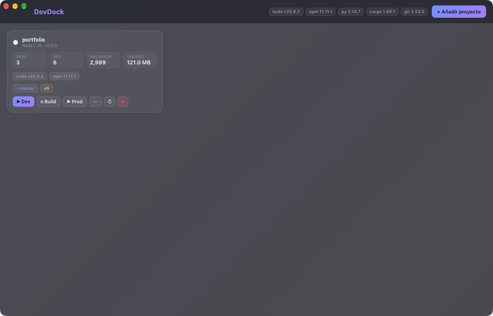
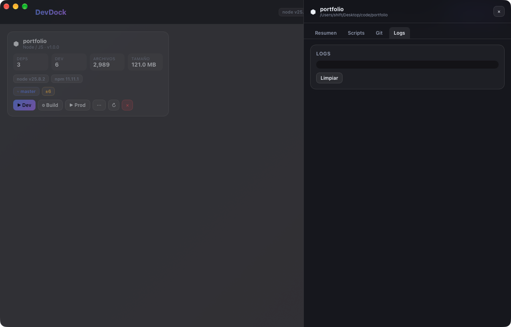

# DevDock

<div align="center">


**Your projects, moored and ready.**

</div>

A project dashboard for macOS: drag & drop folders (Node, Rust, Tauri, Python, Java, Go…) and get metrics, dev servers, builds and the full Git history at a glance.

  

## Screenshots

| Dashboard | Detail (Git graph) | Logs |
|---|---|---|
|  |  |  |

## Features

- **Drag & drop** project folders with automatic type detection (package.json, Cargo.toml, pyproject.toml, pom.xml, go.mod…).
- **Instant metrics**: version, dependencies/devDeps, file count, size, installed runtimes (node/npm/python/cargo/java/go/git).
- **One-click actions**: dev server, build, prod, test — per project type (npm, cargo, gradle, go, pytest). Processes run in their own process group: the ■ Stop button kills the whole tree (npm → vite), not just the wrapper.
- **Git at a glance**: branch, dirty files, ahead/behind, and a commit graph with branch/merge lanes. No repo? One click to `git init`.
- **Live logs** per project (stdout/stderr + exit events).
- **Persistence**: the project list survives app restarts (localStorage).

## Architecture

```
src/                 React 19 + Vite (frontend, glass UI)
src-tauri/           Rust backend (Tauri 2)
  src/commands.rs        project detection, git, tool versions
  src/process_manager.rs process-group spawn/kill, log streaming
  src/models.rs          serde structs (camelCase ⇄ TS)
```

## Development

```bash
npm install
npm run tauri dev        # dev mode
npm run tauri build      # release bundle
```

Backend tests:

```bash
cargo test --manifest-path src-tauri/Cargo.toml --lib
```

## Technical notes

- Processes are spawned in their own **process group** (`process_group(0)`) and stop calls `kill(2)` on the pgid — macOS `kill(1)` misparses negative pids as flags.
- The backend resolves binaries through an extended PATH (`/opt/homebrew/bin`, `~/.cargo/bin`, …) because a launchd/Finder-launched app doesn't inherit your shell PATH.
- Native glass via `window-vibrancy` (`NSVisualEffectMaterial::UnderWindowBackground`), `titleBarStyle: Overlay`.

## CI

`.github/workflows/ci.yml`: frontend build + `cargo test` + debug bundle on a macOS runner for every push/PR.

## First run

Builds are **not code-signed with a Developer ID and not notarized** — there is no certificate in the build. The binary only carries the linker's ad-hoc signature, which is why macOS shows the "unidentified developer" warning when the app arrives from a download.

Until a Developer ID is set up, executing this code on terminal.app:

```bash
xattr -dr com.apple.quarantine /Applications/DevDock.app
```

## License

MIT — see [LICENSE](LICENSE).
